# 《節奏同奏》 (RhythmSync)

<div align="center">

[](https://unity.com/)
[](https://unity.com/)
[](https://unity.com/features/cinemachine)
[](https://unity.com/)
[](https://learn.microsoft.com/dotnet/csharp/)

</div>

## 專案簡介

《節奏同奏 (RhythmSync)》是一款由 Unity 開發的 2D 音樂跑酷遊戲。玩家將隨著音樂節奏奔馳於隨機生成的平台跑道。遊戲以灰階美術風格營造氛圍，並透過音訊快速傅立葉轉換（FFT）頻譜分析即時驅動畫面視覺、鏡頭追焦、UI 律動與多層視差滾動背景。

本專案重點在於 **純 C# 玩家有限狀態機 (FSM)**、**Cinemachine 2D 鏡頭震波脈衝**、**高頻跑道與音符物件池** 與 **本地 JSON 存檔管線**。

---

## 實機展示影片

* 🎥 **實機展示影片**：[https://youtu.be/0h3oy0Y8f0o](https://youtu.be/0h3oy0Y8f0o)

---

## 核心玩法與特色

極簡黑白灰階剪影風格的 2D 節奏跑酷遊戲，將音樂頻譜分析與跑酷操作緊密結合：

* **雙鍵極簡跑酷操控**：
  - 玩家角色在隨機生成的平台上持續向前奔跑，操作核心集中於 **跳躍 (Jump)** 與 **滑行 (Slide)**。
  - 遇到高台或深坑時跳躍（支援空中抓牆攀爬 Ledge Grab）；遇到上方低矮尖刺或移動陷阱時必須及時滑行鑽過。
* **即時音訊頻譜 (FFT) 驅動視聽反饋**：
  - 背景音樂播放時，即時擷取音訊頻譜（`GetSpectrumData`）。
  - 當偵測到音樂重拍（Bass 重低音）瞬間，觸發 **Cinemachine 2D 正交攝影機微幅拉近震波脈衝 (Beat Pulse)**。
  - 同時驅動背景柱狀音波高低跳動與灰階色彩動態閃爍，讓玩家全身沉浸在音樂節拍律動中。
* **音符收集與連擊計分 (Combo System)**：
  - 跑道上擺放懸浮音符，拾取可增加分數並累積 Combo 連擊數；連續拾取分數加成倍增。
  - 若撞上移動障礙物或跌落深坑，觸發受擊擊退或墜落死亡，進入結算面板並自動將最佳成績儲存至本地 JSON。

---

## 系統架構圖

```mermaid
flowchart TD
    subgraph InputAndUI ["UI & 觸控操作層"]
        UIManager["UIManager\n(全域面板調度)"]
        GameHudView["GameHudView\n(分數與連擊 HUD)"]
        EndMenuView["EndMenuView\n(死亡結算視窗)"]
        TouchJumpButton["TouchJumpButton\n(跳躍觸控)"]
        TouchSlideButton["TouchSlideButton\n(滑行觸控)"]
    end

    subgraph InfrastructureLayer ["Infrastructure / 基礎設施"]
        EventBus["EventBus (泛型事件分發中樞)"]
        ObjectPool["ObjectPool (高頻物件池)"]
    end

    subgraph PlayerDomain ["Player / 角色狀態機 (FSM)"]
        PlayerController["Player (物理快取與輸入接收)"]
        StateMachine["PlayerStateMachine (狀態流轉控制器)"]
        States["IPlayerState (Run, Jump, Slide, Ledge, Knockback, Dead)"]
        PlayerController --> StateMachine
        StateMachine --> States
    end

    subgraph GameplayDomain ["Gameplay / 關卡與仲裁"]
        IGameManager["IGameManager (契約)"]
        GameManager["GameManager : IGameManager (計分與遊戲流程)"]
        LevelGen["LevelGenerator (跳台隨機生成)"]
        NoteGen["NoteGenerator (音符生成)"]
        LevelGen -->|取用與回收| ObjectPool
        NoteGen -->|取用與回收| ObjectPool
    end

    subgraph AudioAndVisuals ["Audio & Visuals / 音訊頻譜與視覺"]
        IAudioService["IAudioService (契約)"]
        AudioManager["AudioManager : IAudioService (混音管線與音效播放)"]
        Spectrum["AudioSpectrumProvider (FFT 頻譜分析採樣)"]
        ScaleEffect["SpectrumScaleEffect (音波動態縮放)"]
        ColorEffect["SpectrumColorEffect (灰階色彩律動)"]
        CamPulse["CameraBeatPulse (Cinemachine 正交視野縮放)"]
        Parallax["ParallaxBackground (視差滾動背景)"]
        Spectrum -->|取樣驅動| ScaleEffect
        Spectrum -->|取樣驅動| ColorEffect
        Spectrum -->|發布 BeatPulseEvent| EventBus
    end

    TouchJumpButton -->|觸發指令| PlayerController
    TouchSlideButton -->|觸發指令| PlayerController
    
    PlayerController -->|發布 PlayerDamagedEvent / PlayerDiedEvent| EventBus
    EventBus -->|接收 PlayerDiedEvent| EndMenuView
    EventBus -->|接收 PlayerDiedEvent| GameManager
    EventBus -->|接收 BeatPulseEvent| CamPulse
    
    EventBus -->|接收 NoteCollectedEvent| GameManager
    EventBus -->|接收 NoteCollectedEvent| AudioManager
    GameManager -->|發布 ScoreChangedEvent| EventBus
```



---

## 軟體架構與技術實踐深度說明

### 1. 純 C# 玩家有限狀態機 (Player Finite State Machine / FSM)
* **用了什麼技術**：`PlayerStateMachine` 調度器、`IPlayerState` 抽象介面與 6 大獨立狀態類別（Run, Jump, Slide, Ledge, Knockback, Dead）。
* **為何而用**：跑酷角色在奔跑、跳躍、滑行鑽縫、抓牆攀爬、受擊擊退與死亡結算之間的狀態流轉複雜。若在單一腳本使用多重布林標記（如 `isJumping`, `isSliding`）交錯判斷，極易產生狀態衝突與難以維護的死邏輯。
* **怎麼設計**：將每個狀態實作封裝為獨立的純 C# 類別（不繼承 MonoBehaviour），各狀態內部專責處理自身的 `Enter()`、`Update()`、`FixedUpdate()` 與 `Exit()` 邏輯，並由 `PlayerStateMachine.ChangeState()` 統一進行狀態出入生命週期管理。
* **用什麼方法 (設計模式/原則)**：
  - **狀態模式 (State Pattern)**：單一職責原則 (SRP)，徹底解耦各行為邏輯，新增狀態（如二段跳、滑翔）無需修改現有狀態代碼。

### 2. 即時音訊快速傅立葉轉換 (FFT) 頻譜分析
* **用了什麼技術**：`AudioSpectrumProvider` 呼叫 Unity `AudioSource.GetSpectrumData(samples, 0, FFTWindow.BlackmanHarris)`。
* **為何而用**：達成「音樂驅動視覺」的核心玩法特色，即時捕獲音訊重音拍點，驅動場景與攝影機產生沉浸律動感。
* **怎麼設計**：每幀取樣 64 個頻率區間樣本，加權計算低頻（Bass）區間的平均能量振幅。當低頻能量超過動態閾值且冷卻計時結束時，判定為重音下拍，並透過 `EventBus` 廣播 `BeatPulseEvent`。
* **用什麼方法 (演算法/模式)**：
  - **FFT 快速傅立葉轉換採樣**：搭配 BlackmanHarris 窗函數減少頻譜洩漏。
  - **動態視覺聯動**：
    - `CameraBeatPulse` 訂閱重拍事件，瞬間微幅拉近 Cinemachine 2D 正交視野（Orthographic Size）並平滑插值回彈。
    - `SpectrumScaleEffect` 依據即時頻譜數值縮放背景音波長條 Transform。
    - `SpectrumColorEffect` 依振幅在灰階與亮白色彩間進行線性插值 (Lerp)。

### 3. 高頻跑道與音符物件池 (Object Pooling Pattern)
* **用了什麼技術**：泛型 `ObjectPool`、`IPoolable` 契約結合 `LevelGenerator` 與 `NoteGenerator`。
* **為何而用**：隨機跑酷遊戲每秒皆在生成與銷毀平台跳台、移動陷阱與節奏音符，頻繁呼叫 `Instantiate` 與 `Destroy` 會引發大量 GC Alloc，造成遊戲瞬間卡頓（Jank）影響節奏操作。
* **怎麼設計**：在遊戲載入時預先實例化跳台與音符快取池；生成器在玩家前方動態自物件池取用並拼接跑道，物件脫離畫面後由 `DeadZone` 碰撞觸發回收。
* **用什麼方法**：物件池模式 (Object Pool Pattern)，運行期達到完全無垃圾回收開銷。

### 4. 策略模式本地 JSON 存檔與髒標記排程 (Strategy & Dirty Flag Pattern)
* **用了什麼技術**：`ISaveService` 抽象介面、`JsonSaveService` 實作驅動與 `SaveManager`。
* **為何而用**：保存玩家歷史最高分數與通關數據，避免每次吃音符加分都進行磁碟 I/O 寫入。
* **怎麼設計**：`SaveManager` 於記憶體中維護 `RhythmSaveData` 快取，透過 `ISaveService` 依賴反轉進行 JSON 檔案序列化。
* **用什麼方法**：
  - **策略模式與依賴反轉 (Strategy / DIP)**：儲存細節依賴抽象介面，便於未來抽換儲存媒介。
  - **髒標記模式 (Dirty Flag Pattern)**：分數刷新紀錄時標記 `isDirty`，定時批次落盤寫入本地磁碟。

### 5. Animator 與有限狀態機 (FSM) 協同動畫架構
* **用了什麼技術**：Unity `Animator` 組件與純 C# `PlayerStateMachine`。
* **為何而用**：若在 Animator Controller 內部手動拉出複雜交錯的轉移線（Transitions），極易產生蜘蛛網般的過渡條件衝突（Spaghetti Transitions）且難以追蹤狀態機 Bug。
* **怎麼設計**：由純 C# 狀態類別掌握動畫播送主導權。在 `Player.cs` 快取 `Animator` 組件，當 FSM 執行狀態切換（如進入 `PlayerRunState`、`PlayerJumpState`、`PlayerSlideState`）時，於 `Enter()` 生命週期中精確調用 `Player.Anim.Play()` 或設定參數，退出時重置狀態。
* **用什麼方法**：代碼驅動動畫狀態機 (Code-Driven Animation Architecture)、狀態模式 (State Pattern)。

---

## 核心介面契約規範 (Interfaces)

| 介面契約 (Interface) | 實作類別 (Implementation) | 職責說明 |
| :--- | :--- | :--- |
| `IPlayerState` | 6 大狀態類別 (`Player...State`) | 定義單一角色狀態進入、每幀更新與退出生命週期 |
| `IGameManager` | `GameManager` | 維護遊戲計分、連擊倍率計算與遊戲結束結算 |
| `ISaveManager` | `SaveManager` | 存檔狀態快取仲裁、髒標記追蹤與最高紀錄更新 |
| `ISaveService` | `JsonSaveService` | 抽象化磁碟序列化行為，負責 JSON 檔案存取 |
| `IAudioService` | `AudioManager` | 集中調度背景音樂、音效播放與混音音量控制 |
| `IPoolable` | `Platform`, `Note` | 定義跳台與節奏音符自物件池取出與歸還之重置契約 |

---

## 模組架構與檔案拓撲 (Architecture Topology)

```text
rhythm-sync/
├── Player/             # 純 C# 玩家有限狀態機 FSM (6 大狀態類別, PlayerStateMachine)
├── Gameplay/           # 核心跑酷玩法、無限跑道與音符生成器 (LevelGenerator, NoteGenerator)
├── Visuals/            # 音樂頻譜視覺聯動 (Cinemachine 鏡頭震波 CameraBeatPulse, 視差背景)
├── Audio/              # 即時頻譜採樣與音訊服務 (AudioSpectrumProvider, AudioManager)
├── Infrastructure/     # 泛型 EventBus 事件匯流排與零 GC 物件池 (ObjectPool)
├── Save/               # 策略模式本地 JSON 存檔 (SaveManager, JsonSaveService)
└── UI/                 # 遊戲 HUD、節拍連擊判定與結算面板 (UIManager, GameHudView)
```
